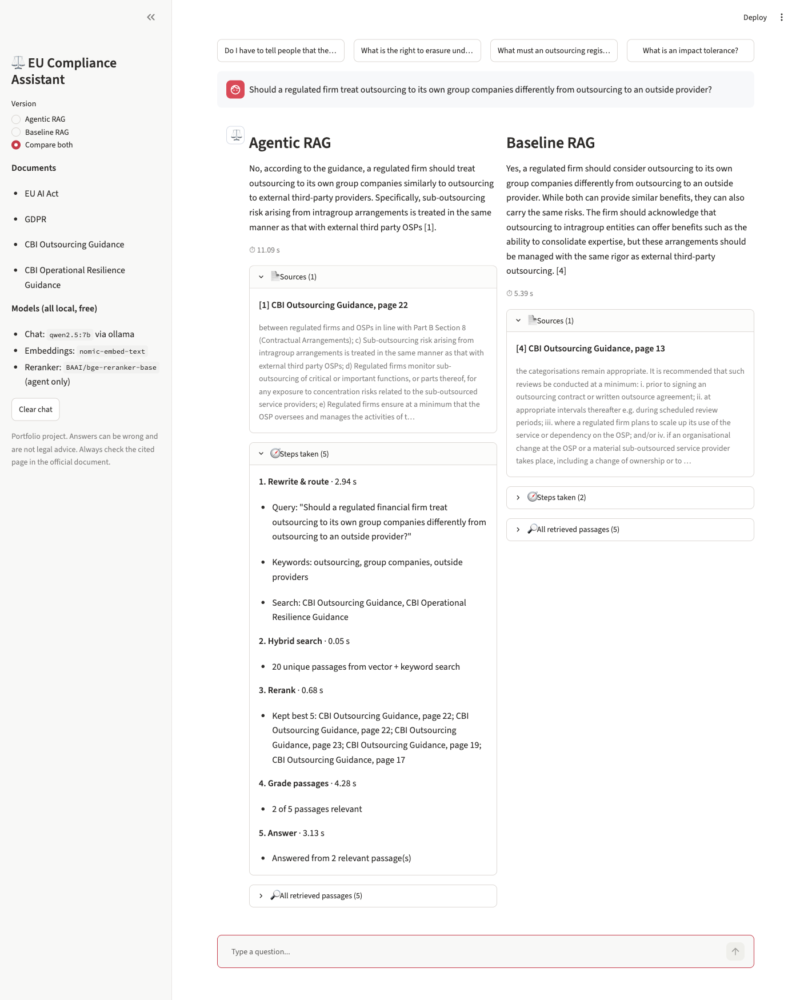
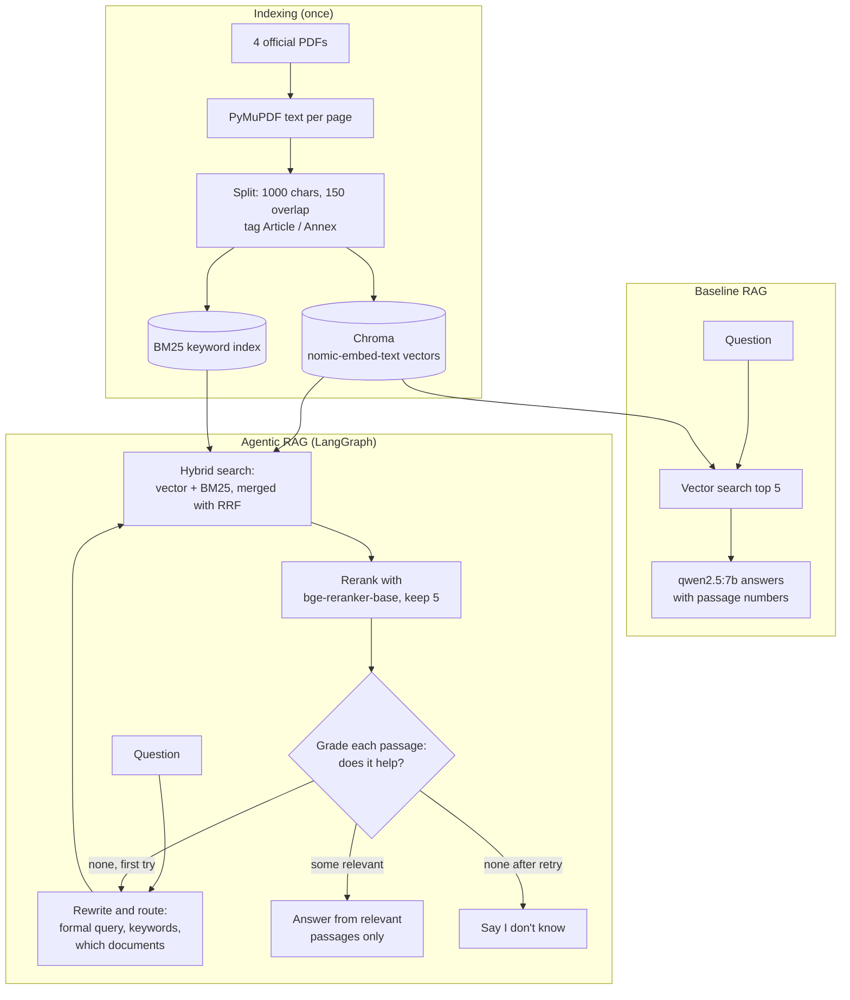
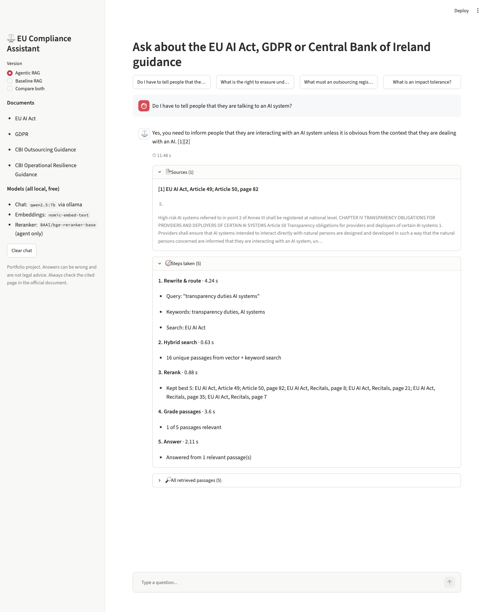
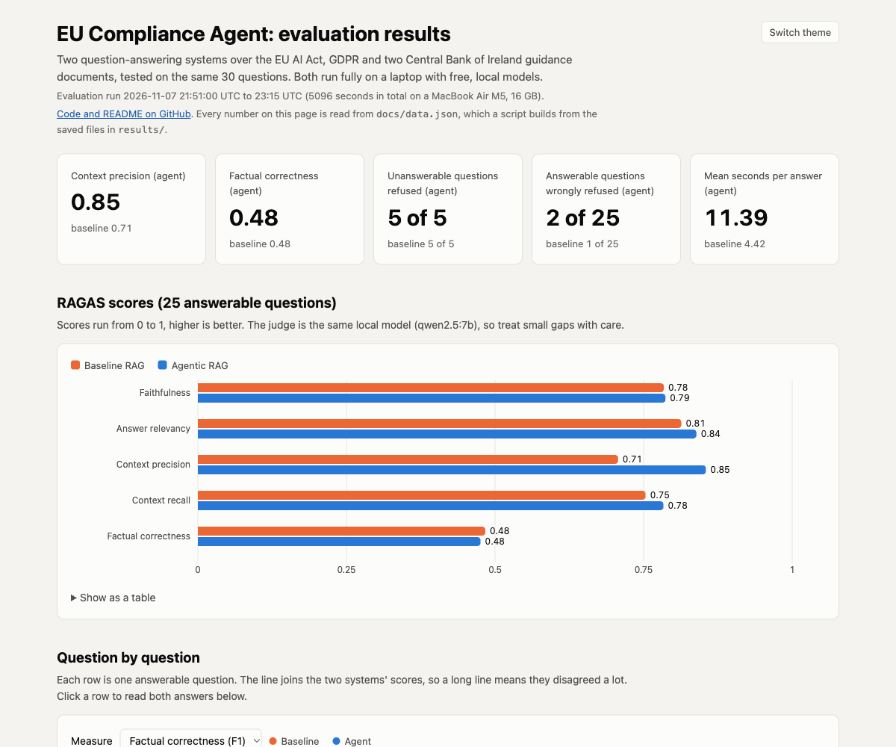

# EU Compliance Agent

A question-answering assistant for the **EU AI Act**, **GDPR** and two **Central Bank of Ireland** guidance documents. Every answer cites the document and page it came from. It runs fully on a laptop with free, local models.

The project builds the assistant twice, a **basic RAG** and an **agentic RAG** built with LangGraph, and tests both on the same 30 questions to see whether the extra agent steps actually help.

**Results dashboard:** https://ahmaduzzam31.github.io/eu-compliance-agent/



## The problem

Compliance staff at Irish banks, insurers and fintechs have to find exact rules across long legal texts, for example "how quickly must we report a data breach?" or "is our credit scoring AI high-risk?". A general chatbot can make up an answer. This assistant answers only from the official documents, shows the page it used, and says "I don't know" when the documents do not cover the question.

## Data

Four official public documents, downloaded by `scripts/download_data.py`. The script records each source link, version, page count and SHA-256 checksum in `data/sources.csv`.

| Document | Publisher | Version | Pages | Passages |
|---|---|---|---|---|
| Regulation (EU) 2024/1689 (Artificial Intelligence Act) | EUR-Lex | OJ L, 12.7.2024 | 144 | 743 |
| Regulation (EU) 2016/679 (General Data Protection Regulation) | EUR-Lex | OJ L 119, 4.5.2016 | 88 | 448 |
| Cross-Industry Guidance on Outsourcing | Central Bank of Ireland | December 2021 | 73 | 218 |
| Cross Industry Guidance on Operational Resilience | Central Bank of Ireland | July 2025 | 35 | 88 |

The PDFs are not stored in this repo. Run the download script to fetch them. Passage counts come from `results/index_stats.json` (1,497 passages in total).

The 30 test questions are in `eval/test_questions.json`:
- 8 on the AI Act, 8 on GDPR, 4 on outsourcing and 3 on operational resilience;
- 2 that need two documents together;
- 5 that the documents **cannot** answer (for example, "When will the digital euro be launched?").

The questions and reference answers were drafted with AI help (Claude), then checked by hand against the cited pages before the evaluation was run.

## Architecture



Both versions use **the same answer prompt and the same model**, so any difference comes from how passages are found and checked.

| Part | Tool | Its one job |
|---|---|---|
| Chat model | `qwen2.5:7b` through Ollama | rewrite, grade and answer (temperature 0, seed 42) |
| Embeddings | `nomic-embed-text` through Ollama | turn passages and questions into vectors |
| Vector store | Chroma | store the vectors on disk and search them |
| Keyword search | `rank_bm25` | find exact legal terms such as "Article 33" |
| Reranker | `BAAI/bge-reranker-base` (sentence-transformers) | put the best passages first |
| Agent | LangGraph | the rewrite, search, grade, retry or refuse loop |
| Model layer | LangChain `init_chat_model` | swap to OpenAI, Claude or Gemini by changing `.env` only |
| App | Streamlit | chat with sources and the agent's steps |
| Evaluation | RAGAS 0.4.3 | score answers with the local model as judge |

## How to run

You need a Mac or Linux machine with Python 3.12 and [Ollama](https://ollama.com). It was built on a MacBook Air M5 with 16 GB.

```bash
git clone https://github.com/ahmaduzzam31/eu-compliance-agent.git
```

```bash
cd eu-compliance-agent && python3.12 -m venv .venv && .venv/bin/pip install -r requirements.txt
```

```bash
ollama pull qwen2.5:7b && ollama pull nomic-embed-text
```

```bash
cp .env.example .env
```

```bash
.venv/bin/python scripts/download_data.py
```

```bash
.venv/bin/python scripts/build_index.py
```

Then start the app:

```bash
.venv/bin/streamlit run app.py --server.address localhost
```

Or ask one question from the terminal:

```bash
.venv/bin/python scripts/ask.py --system agent "How quickly must a personal data breach be reported?"
```

To repeat the evaluation, run the next command. It took 5096 seconds (just under 85 minutes) on the MacBook Air. Most of that time is RAGAS judging, not answering.

```bash
.venv/bin/python scripts/evaluate.py
```

```bash
.venv/bin/python scripts/build_dashboard_data.py
```

To use a paid model instead, set `LLM_PROVIDER`, `LLM_MODEL` and that provider's API key in `.env` and install its LangChain package (for example `langchain-anthropic`). No code changes are needed.

## Results

One run on 30 questions, 2026-11-07, models as above. The table is copied from `results/results_table.md`, which `scripts/build_dashboard_data.py` writes from `results/summary.json`. The RAGAS scores cover the 25 answerable questions; the refusal rows cover all 30.

| Measure | Baseline RAG | Agentic RAG |
|---|---|---|
| Faithfulness (mean of 25 / 25 scored) | 0.784 | 0.7867 |
| Answer relevancy (mean of 25 / 25 scored) | 0.8134 | 0.8388 |
| Context precision (mean of 25 / 25 scored) | 0.7071 | 0.8547 |
| Context recall (mean of 25 / 25 scored) | 0.7533 | 0.7833 |
| Factual correctness (F1) (mean of 25 / 25 scored) | 0.4836 | 0.4756 |
| Unanswerable questions correctly refused | 5 of 5 | 5 of 5 |
| Answerable questions wrongly refused | 1 of 25 | 2 of 25 |
| Mean seconds per answer | 4.42 | 11.39 |
| Median seconds per answer | 4.24 | 11.28 |

What this shows:

- **The agent finds better passages.** Context precision rose from 0.7071 to 0.8547: more of what the agent gives the model is actually useful. Recall and answer relevancy also rose slightly.
- **Better passages did not give more correct answers.** Factual correctness was about the same (0.4836 against 0.4756). With a 7B model, the final writing step limits the result.
- **Both refused all 5 unanswerable questions**, so neither made up an answer on those.
- **The agent wrongly refused 2 answerable questions (Q05, Q22), the baseline 1 (Q11).** The saved agent steps in `results/answers_agent.jsonl` show why:
  - In Q22, the agent found the right pages, but the grading step marked all 5 passages as not relevant. It then retried with the same query.
  - In Q05, the rewrite turned a question about AI reading employees' emotions into a GDPR question, and it never reached Article 5 of the AI Act.
- **The agent is slower:** 11.39 s against 4.42 s per answer on average, because it makes extra model calls: a rewrite, five grades and sometimes a retry.

Per-question scores are in `results/ragas_baseline.csv` and `results/ragas_agent.csv`. Every answer, with its passages and steps, is in `results/answers_*.jsonl`. The [dashboard](https://ahmaduzzam31.github.io/eu-compliance-agent/) lets you read both answers to any question side by side.

## Screenshots

| Agent answer with source and steps | Results dashboard |
|---|---|
|  |  |

## Limitations

- **Small test set and a single run:** 30 questions. A difference of a few hundredths could change with other questions.
- **The judge is the same small model.** RAGAS used `qwen2.5:7b` to score answers written by `qwen2.5:7b`, which can be lenient towards itself, and single scores can be wrong. For example, in Q17 factual correctness gave the baseline's wrong "Yes" 0.55 and the agent's correct "No" 0.40.
- **The grading step is too strict at times** (Q22), and **a retry can repeat the same query**, so the retry does not always try anything new.
- **The model sometimes cites passage numbers that do not exist.** The code drops these, so a sentence can end up with no citation.
- **Passages are split within a page.** A rule that runs across two pages can be cut in half.
- **The test questions were drafted with AI help.** They were checked by hand, but they may still lean towards wording the system finds easy.
- Not legal advice. The documents are a snapshot, and later changes to the law are not included.

## Next steps

- Make the grading step less strict, or keep the best passage when all are rejected, then re-test on **new** questions, not the same 30, to avoid tuning to the test.
- Make the retry change its wording for real (for example, the agent sees the passages it rejected).
- Run the judge with a different, stronger model, and add a blind human check of a sample of answers to measure how often the judge agrees.
- Add more Central Bank documents and the DORA regulation.
- Serve the agent through FastAPI so other tools can call it.

## Repo layout

```
app.py                     Streamlit app
src/                       config, models, indexing, retrieval, reranker, prompts, baseline, agent
scripts/                   download_data, build_index, ask, evaluate, build_dashboard_data
eval/test_questions.json   30 checked test questions
results/                   every number in this README
docs/                      GitHub Pages dashboard and screenshots
INTERVIEW_NOTES.md         likely interview questions and answers
```
